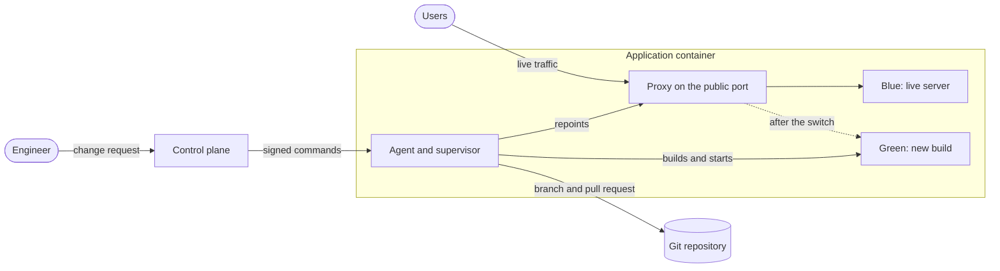
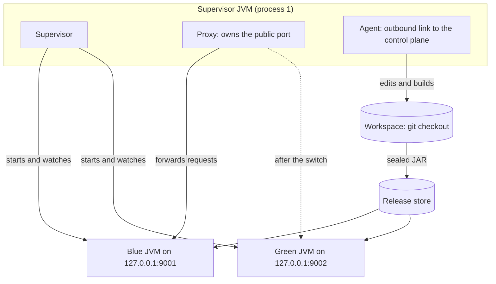
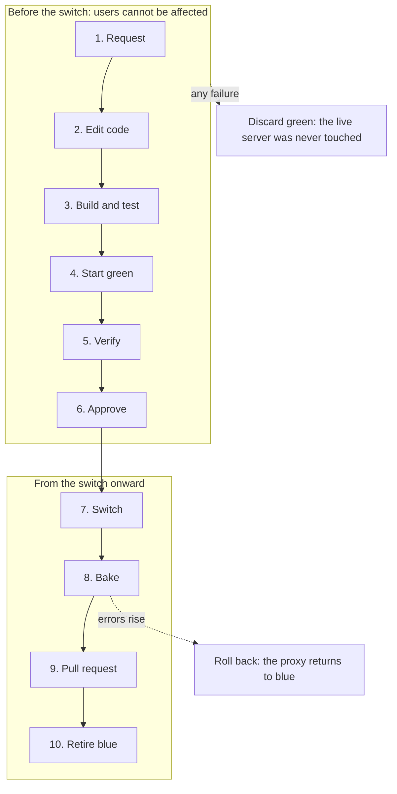
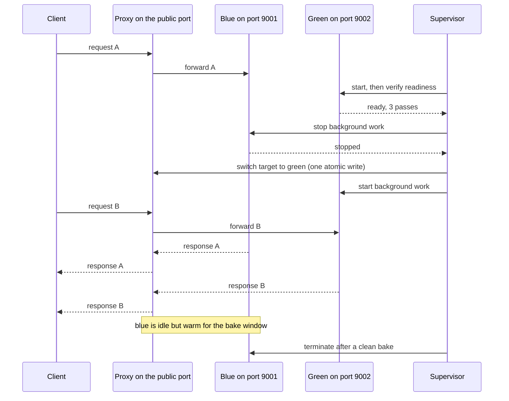
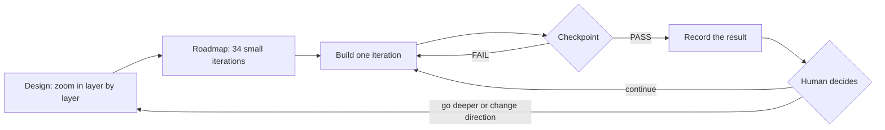

<h1 align="center">Hot Server Swap</h1>

<p align="center">
  <b>Change a live server's code, rebuild it, and switch traffic to the new build.<br>
  Inside one container. Without dropping a request.</b>
</p>

<p align="center">
  <i>Working name: Live Server Agent (LSA) · Java 21 · Spring Boot starter · built in the open, one checkpoint at a time</i>
</p>

---

## The idea

Deployed applications run in containers, and changing them means a full pipeline: commit, build an image, roll it out. That loop is slow when you are chasing a bug that only shows up on a real server.

Hot Server Swap puts an authenticated agent inside the container. The agent can change the server's code, build it, start the new build beside the running one, and switch traffic over. The container never restarts and the public port never goes quiet.

The one rule that makes this safe: **the live server is never edited in place.** A second copy is built beside it, proven healthy, and only then does a small proxy start sending it traffic. The old copy stays warm, so going back takes less than a second.

| Term | Meaning |
|------|---------|
| **Blue** | The server process answering users right now |
| **Green** | The new build, running beside blue, receiving no user traffic yet |
| **Switch** | The moment the proxy starts sending requests to green |
| **Bake** | The few minutes after a switch when green is watched and blue is kept warm |

## Contents

- [How to read this document](#how-to-read-this-document)
- [Layer 0: the whole system](#layer-0-the-whole-system)
- [Layer 1: inside the container](#layer-1-inside-the-container)
- [Layer 2: the life of one change](#layer-2-the-life-of-one-change)
- [Layer 3: the mechanics](#layer-3-the-mechanics)
- [Spring Boot integration](#spring-boot-integration)
- [Security model](#security-model)
- [How this project is built](#how-this-project-is-built)
- [Roadmap](#roadmap)
- [Status](#status)
- [Run it](#run-it)

## How to read this document

The design is written as zoom levels. Each layer takes one box from the layer above and opens it up.

| Layer | Question it answers |
|-------|---------------------|
| **0** | Who and what is involved, end to end? |
| **1** | What runs inside the container, and what does each part own? |
| **2** | What happens, step by step, to a single change? |
| **3** | How does each risky step work at the level of ports, processes and files? |

Read top-down for the picture, or jump to layer 3 for the engineering.

---

## Layer 0: the whole system

Four parties are involved: an engineer, a control plane, the container, and git. Users never notice a change, because they only ever talk to the proxy.



1. An engineer describes a change in the control plane.
2. The control plane plans the change and sends signed commands to the agent.
3. The agent edits a copy of the source, pushes it to a git branch, and builds it into a new release.
4. The supervisor starts the new release as green on an internal port and checks it.
5. After approval, the proxy switches traffic from blue to green.
6. Green is watched for a few minutes. If it misbehaves, the proxy switches back. If it holds, blue is retired and a pull request records the change.

The agent dials **out** to the control plane. The container opens no extra inbound port.

---

## Layer 1: inside the container

One small Java program, the supervisor, is process 1 of the container. It runs the proxy and the agent, and it starts the server JVMs as its children. That is why the container stays up while servers come and go.



| Part | What it owns | If it fails |
|------|--------------|-------------|
| **Supervisor** | Process 1. Starts, stops and watches the server JVMs. Keeps the change journal. | The container exits and the platform restarts it. |
| **Proxy** | The public port. Forwards each request to whichever server is active. | Same as the supervisor; it runs in the same JVM. |
| **Agent** | The outbound link to the control plane. Edits the workspace, runs builds, asks for a switch. | Its threads are restarted. Live traffic is unaffected. |
| **Blue server** | The JVM serving traffic now. | The supervisor restarts it from the same release. |
| **Green server** | The candidate JVM on an internal port. | The change is discarded. Blue never noticed. |
| **Workspace** | A git checkout the agent edits and builds. | Deleted and cloned again. |
| **Release store** | Sealed builds, one JAR each, plus `current` and `previous` pointers. | Rebuilt from the git commit. |

Decisions at this layer:

- **The supervisor is plain Java with no framework.** Small heap, fast start.
- **Supervisor, proxy and agent share one JVM at first**, to save memory. Moving the agent into its own process is the first hardening step.
- **Peak load is three JVMs.** The supervisor and blue always run. The third is either the build or green; the build finishes before green starts.

---

## Layer 2: the life of one change

A change passes through ten steps. Users can only be affected from step 7 onward. Every failure before that point throws green away and leaves blue exactly as it was.



| # | Step | What happens | Moves on when | If it fails |
|---|------|--------------|---------------|-------------|
| 1 | Request | The agent checks the command's signature, expiry and target, then takes the change lock. | The lock is held. | Rejected, or "busy" if a change is in flight. |
| 2 | Edit code | The workspace is reset to the commit blue runs. The edit is applied and pushed to a change branch. | The diff is in git. | Discard. |
| 3 | Build and test | The project's build runs under CPU and memory limits. The JAR is copied into a new sealed release. | Exit code 0. | Discard. |
| 4 | Start green | Memory headroom is checked, then the JAR starts on a free loopback port in standby mode. | The JVM is listening. | Discard. |
| 5 | Verify | Readiness must pass 3 times in a row. Smoke requests then hit green directly and warm the JVM. | All pass in time. | Discard. |
| 6 | Approve | The diff, test output and health results go to a person. Staging can auto-approve by policy. | A signed approval arrives. | Discard on rejection or timeout. |
| 7 | Switch | Blue's background work stops, the proxy repoints, green's background work starts. | Green serves a request. | Switch back. |
| 8 | Bake | Blue stays warm with no traffic. Green's error rate and latency are compared with blue's. | The window passes clean. | Roll back. |
| 9 | Pull request | The change branch becomes a pull request marked as verified live. | The pull request exists. | Stays live, flagged and alerted. |
| 10 | Retire blue | Blue finishes its work and exits. Its release stays on disk for rollback. | Blue has exited. | Force-kill after a grace period. |

Rules that hold the lifecycle together:

- **One change at a time per container.** A lock from step 1 to step 10.
- **Write first, act second.** Each transition is journaled to disk before the supervisor acts on it.
- **Standby mode.** Green starts with scheduled jobs and message consumers held back. Two servers answering requests is safe. Two servers running the same nightly job is not.
- **A gap beats an overlap.** At the switch, blue's background work stops before green's starts.

---

## Layer 3: the mechanics

### 3.1 How the port changes hands

It doesn't. The proxy binds the public port once when the container starts and holds it for the container's whole life. A switch only changes which internal server the proxy forwards to.

The obvious approach fails because only one process can listen on a port. If green binds while blue holds it, the bind fails. If blue stops first, connections are refused in the gap, and a green that fails to start leaves nothing to fall back to.

| Option | How it works | Weakness | Verdict |
|--------|--------------|----------|---------|
| **In-container proxy** | The proxy owns the public port. Blue and green listen on loopback. The proxy changes its target. | One extra local hop per request. | **Chosen** |
| Shared port (`SO_REUSEPORT`) | Both servers bind the same port and the kernel spreads connections across them. | Traffic splits during the overlap, and queued connections are reset when blue closes. | Rejected |
| Socket handoff | The supervisor opens the socket and passes it to each server. | Awkward on the JVM, and no per-request control. | Rejected |
| Firewall redirect | A packet-filter rule redirects the public port. | Needs a capability most platforms deny to containers. | Rejected |
| Reload classes in the live JVM | Hot reload swaps classes without a new process. | No clean rollback, limits on what can change, class-loader leaks. | Rejected |

The switch, request by request:



Request A was already on blue, so it finishes on blue. Request B arrived after the switch, so it goes to green. Nothing pauses and no lock is held. Rollback is the same write in reverse.

Why users see nothing:

- **Client connections end at the proxy.** A keep-alive connection stays open across the switch. Only the proxy's own connections to the servers change.
- **The platform's health probe hits the proxy**, which answers from the active server. The container stays healthy throughout.
- **Servers bind loopback only.** Nothing outside the container can bypass the proxy.
- **Long-lived connections** such as WebSocket stay pinned to blue through the bake, then are closed with a "going away" code so clients reconnect onto green.

### 3.2 Builds and releases

A build never touches the files the live server runs from. Each build produces a new sealed directory, and "which release is live" is a single pointer.

```
/opt/lsa/
  workspace/                  git checkout the agent edits and builds
  releases/
    20261116-0152-a1b2c3d/    one sealed, read-only release
      app.jar                 the executable JAR
      manifest.json           commit, build command, checks, result
  current  -> releases/...    the release blue runs
  previous -> releases/...    the cold rollback target
  journal.log                 append-only record of every transition
```

- **A release id is a UTC time plus the short commit hash**, so any running server traces back to its exact source.
- **Sealed means read-only.** A running JVM keeps its JAR open; changing it underneath breaks class loading.
- **Pointers move atomically**: the new link is created beside the old one and renamed over it.
- **Builds run under limits.** Blue's latency matters more than build speed.
- **Green gets blue's exact environment.** Only the listen address, release id and standby flag differ.
- **Memory is budgeted explicitly.** A JVM sized as a share of container memory assumes it is alone. The supervisor caps each child's heap and refuses to start green without headroom.

### 3.3 Health checks, draining and rollback

Green proves itself four ways before the switch:

| Check | How | Passes when |
|-------|-----|-------------|
| Liveness | The supervisor watches the child process. | The JVM is running. |
| Readiness | The readiness endpoint on green's port. | 3 passes in a row. |
| Smoke | Configured requests sent to green directly. | Every response has the expected status. |
| Warm-up | The smoke requests repeated. | A cold JVM has been exercised before users reach it. |

During the bake, the proxy measures error rate and latency per release itself, since every request passes through it. Rollback does not depend on an outside monitoring system.

| Rollback | When | How | Time |
|----------|------|-----|------|
| **Warm** | During the bake | The proxy switches back to blue, which is still running. | Under a second |
| **Cold** | After blue is retired | The previous release starts as a new green and goes through the normal lifecycle. | One JVM start |
| **Baseline** | The container restarts | The platform starts the image's original build. | One container start |

### 3.4 Persistence and replicas

**Git is the source of truth; the container is a cache of it.** Code is pushed to a change branch before it is built, so nothing runs that git does not have. A change is finished only when its pull request is merged and the normal pipeline has produced a new image.

For services with several replicas: the change is built and verified on one canary, the sealed JAR is published under its hash so every replica runs identical bytes, and the rest follow in batches. A failure in any batch stops the rollout.

---

## Spring Boot integration

The goal is setup by configuration alone: one dependency and a block of properties.

```yaml
lsa:
  enabled: true
  control-plane-url: https://lsa.example.com
  build:
    command: ./mvnw -q verify
  health:
    path: /actuator/health/readiness
    passes-required: 3
  smoke:
    - GET /api/ping -> 200
  bake: 5m
  drain: 30s
  approval: required
```

*Names are placeholders until the starter exists.*

**One JAR, two roles.** `java -jar app.jar` runs as it does today. Before the application context starts, the starter checks for a supervisor above it. If there is none, this JVM becomes the supervisor and launches a second JVM from the same JAR as blue. The Dockerfile's entrypoint does not change.

Inside each server the starter provides the listen address handed down by the supervisor, standby mode for scheduled tasks and message listeners, promote and demote hooks, graceful shutdown, the release id in logs and metrics, and a guard that keeps database migrations off green.

## Security model

This tool is remote code execution by design, so the security model is the product.

| Link | Credential |
|------|------------|
| Engineer to control plane | Single sign-on with a second factor, and roles for requesting and approving |
| Container, first contact | A one-time enrollment token; the key pair is generated inside the container |
| Container, afterwards | A short-lived client certificate on a connection the agent opens outward |
| Each command | A signature, a one-use number, an expiry and a target check |
| Agent to git | A token for one repository that cannot push the default branch |

The AI model's reasoning loop runs in the control plane, never in the container. The in-container agent exposes five narrow tools and no shell: read a workspace file, write a workspace file, run the configured build, read build output and logs, and request a switch. A model misled by text in code or logs cannot run arbitrary commands or read secrets.

---

## How this project is built

This repository is also an experiment in **a long-running AI workflow**: a person and an AI model building a non-trivial system together across many sessions, without the work drifting or having to be re-explained each time.



The rules of the loop:

- **Design before code.** The layers above were written before the first line of Java.
- **Zoom in, then build.** Each iteration takes one box from the design and makes it real.
- **Small steps.** An iteration is sized for a few minutes of build time. Bigger ones are split before they start.
- **A checkpoint ends every iteration.** It is a script that prints `PASS` or `FAIL`. No iteration starts until the previous one passes.
- **A checkpoint must be able to fail.** Where it claims zero dropped requests, it also shows that dropped requests are detected.
- **Checkpoints accumulate.** Every earlier one is re-run, so a new step cannot quietly break an old one.
- **The human steers.** After each checkpoint a person decides: continue, go deeper, or change direction.
- **Risk sets the order.** The mechanics that could drop a request come first. No AI touches a live server until they are proven.

What keeps a long-running effort coherent is that its state lives outside any single session:

| Record | Where it lives | What it holds |
|--------|----------------|---------------|
| Design | This README and a longer design document | The layers, decisions and trade-offs |
| Roadmap | The section below | Every iteration and its checkpoint |
| Proof | `checkpoints/` | One runnable script per iteration |
| Agent rules | `CLAUDE.md` | How an AI agent must work in this folder |
| Progress | The status table and git history | What passed, and when |
| Context | The assistant's project memory | Decisions and preferences carried between sessions |

The AI collaborator is Claude. Commits it writes are marked as co-authored.

---

## Roadmap

Thirty-four iterations in four stages, ordered from medium to hardest. Each row is one iteration and the checkpoint that ends it.

<details open>
<summary><b>Stage A · medium · the core loop on one container (0 to 9)</b></summary>

<br>

Proves the switch itself with no framework, no network and no AI. A plain-Java server stands in for the real app.

| # | Build | Checkpoint |
|---|-------|------------|
| 0 | Stand-in server and a fixed-rate load generator | 0 failures on a healthy server; failures reported when it is killed |
| 1 | Proxy skeleton on the public port | 0 failures through the proxy; added latency printed |
| 2 | Supervisor starts the server as a child JVM | A killed child comes back; its port is loopback-only |
| 3 | Green beside blue on a second port | Both answer; the public port still answers from blue |
| 4 | Atomic switch, release id in a header | 100 switches under load with 0 failures |
| 5 | Health gate | A green that never becomes ready is refused |
| 6 | Drain and retire | A 10 s request finishes on blue; a stuck blue is force-killed |
| 7 | Release store | 3 releases kept, pointers right, sealed files unwritable |
| 8 | Journal and change lock | A concurrent change gets "busy"; the journal replays to the same state |
| 9 | One command runs lifecycle steps 4 to 10 | A new JAR goes live under load with 0 failures |

</details>

<details>
<summary><b>Stage B · hard · the edges that break real apps (10 to 20)</b></summary>

<br>

Where a demo becomes something a real Spring Boot service can survive.

| # | Build | Checkpoint |
|---|-------|------------|
| 10 | Bake window and warm rollback | A green returning errors is rolled back in under 1 s, unattended |
| 11 | Cold rollback | One command restores the previous release after blue is retired |
| 12 | Memory budget | Green is refused when headroom is short; 20 changes with no kernel kill |
| 13 | Real Spring Boot app and starter skeleton | Every Stage A checkpoint passes against it |
| 14 | Standby mode for scheduled tasks | A once-a-second job never ticks twice across 100 switches |
| 15 | Standby for message listeners; capped database pool | Each message consumed once; connections stay under the limit |
| 16 | Migration guard | A change touching migrations is refused |
| 17 | Long-lived connections | A WebSocket client is told to reconnect and lands on green |
| 18 | One JAR in two roles | An unchanged Dockerfile yields supervisor plus child |
| 19 | Build inside the container | A one-line edit goes live with one command; blue's latency stays in bounds |
| 20 | Crash recovery | Supervisor killed at each lifecycle step; the port always comes back good |

</details>

<details>
<summary><b>Stage C · hard · trust and security (21 to 25)</b></summary>

<br>

Makes the tool safe to reach from outside the container. Changes are still plain patches.

| # | Build | Checkpoint |
|---|-------|------------|
| 21 | Control-plane stub and enrollment | Connects with no inbound port; a reused token is rejected |
| 22 | Signed commands | Forged, replayed, expired and mistargeted commands are each rejected |
| 23 | Five narrow tools with path checks | Reads and writes outside the workspace fail |
| 24 | Approval and audit | A patch goes live only after approval and leaves a complete record |
| 25 | Git as the record | A failed push discards the change; a clean bake opens a pull request |

</details>

<details>
<summary><b>Stage D · hardest · AI changes and many replicas (26 to 33)</b></summary>

<br>

The two problems with no standard answer: trusting changes a model wrote, and keeping many copies identical.

| # | Build | Checkpoint |
|---|-------|------------|
| 26 | The model loop, using the five tools | A described change reaches a verified pull request on staging |
| 27 | Hostile-input tests | The model never acts outside its tools; no secret leaks |
| 28 | Change quality gate | Untested, oversized or protected-path changes are refused |
| 29 | Desired release and replay | A restarted container returns to the desired release |
| 30 | Artifact store | The JAR hash is identical on every replica |
| 31 | Canary, then batches | A failure in the second batch stops the rollout and restores the first |
| 32 | Drift alerts and joining replicas | A new replica converges; a hand-changed one raises an alert |
| 33 | Chaos run | Failures stay in budget and every replica ends on the same release |

</details>

## Status

| # | Iteration | Result | Evidence |
|---|-----------|--------|----------|
| 0 | Stand-in server, load generator, checkpoint | Passed, 16 Nov 2026 | 1,000 of 1,000 requests answered on a healthy server; 658 failures reported when it was killed |
| 1 | Proxy skeleton on the public port | Next | |

Everything above iteration 0 is design, not yet code.

## Run it

Requirements: JDK 21 or later, `bash` and `curl`. No Maven or Gradle is needed until the Spring Boot iterations.

```bash
cd hot-server-swap
bash checkpoints/checkpoint-00.sh
```

Expected last line: `CHECKPOINT 0: PASS`

```
hot-server-swap/
├── sample/SampleServer.java      stand-in app: /ping, /slow?ms=N, /health/readiness, a 1 s background job
├── loadgen/LoadGen.java          fixed-rate load generator that counts every non-200 response
├── checkpoints/checkpoint-00.sh  builds and runs checkpoint 0
└── CLAUDE.md                     working rules for AI agents in this folder
```
