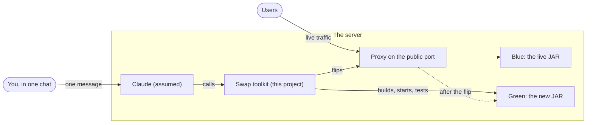
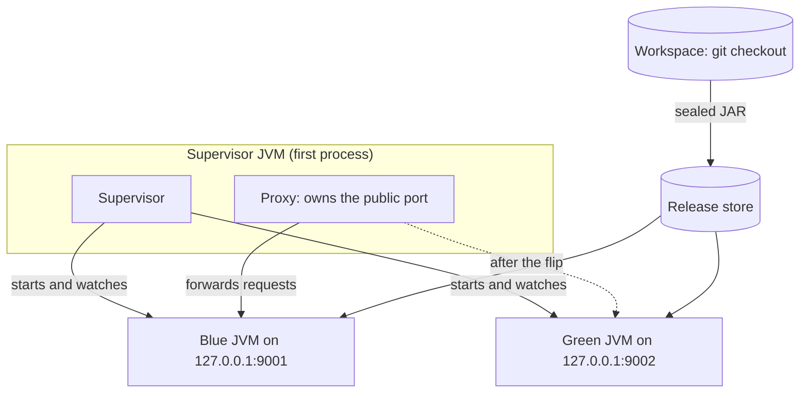
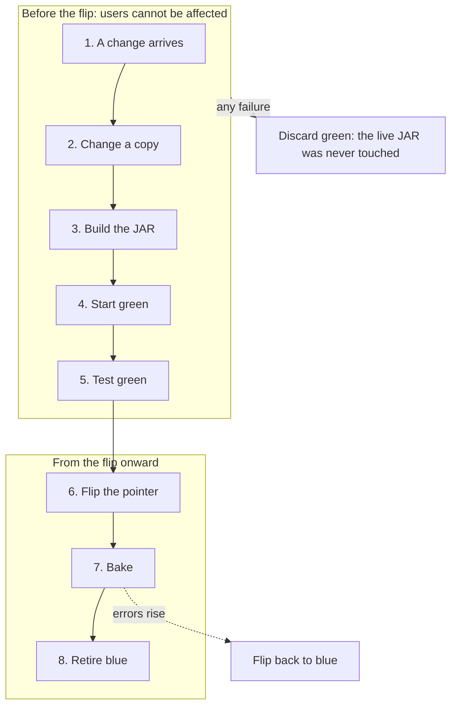
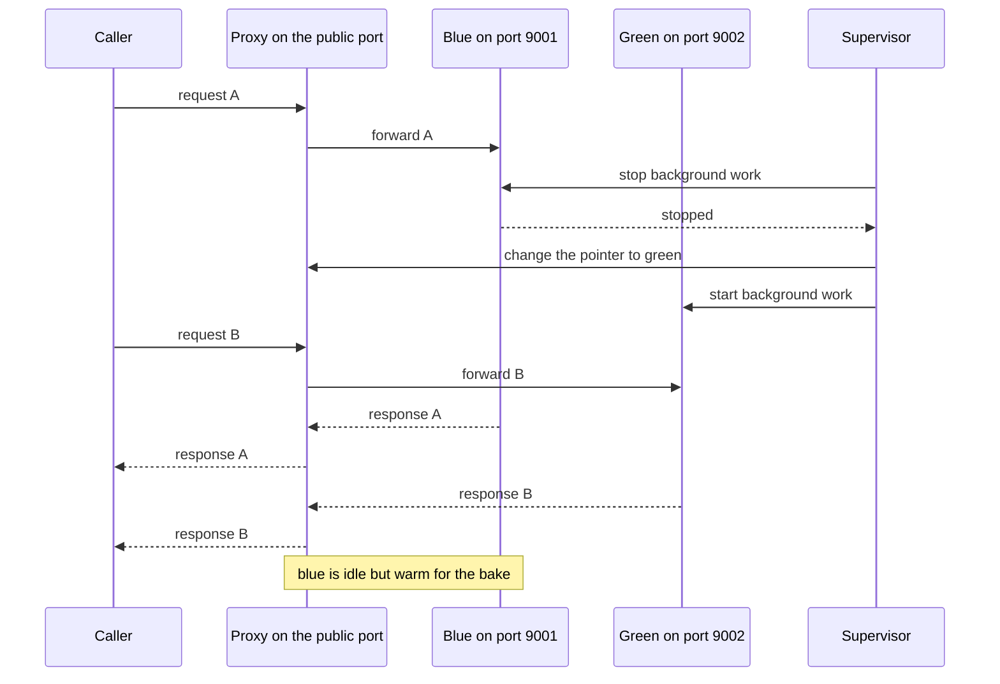
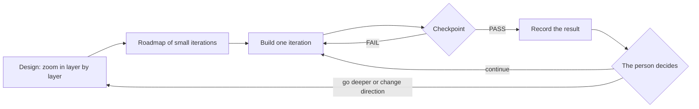

<h1 align="center">Hot Server Swap</h1>

<p align="center">
  <b>Change a live server's code and swap the JAR.<br>
  On the server itself. Without dropping a request.</b>
</p>

<p align="center">
  <i>Java 21 · Spring Boot · built in the open, one checkpoint at a time</i>
</p>

<p align="center">
  <a href="https://amitdu6ey.github.io/experiments/exp/hot-server-swap/"><b>Walk the project map</b></a><br>
  <sub>Every cloud opens into its own universe. The map goes live when this branch is merged to main.</sub>
</p>

---

## The problem

A production server is running: an EC2 instance, a container, any machine. You want to change its code. The normal route is a full pipeline, and during it something upstream has to be told that the server moved: a load balancer, a registry, a DNS record. With ten servers that is ten sets of changes in ten places.

This project takes a different route. **Put one pointer in front of the server that says where it lives, and a swap becomes changing that pointer.** The new JAR is built and tested beside the live one, on the same machine, and then one write in memory moves the traffic. Nothing outside the server knows anything happened.

The rule that makes it safe: **the running JAR is never touched.**

| Word | Meaning |
|------|---------|
| **Blue** | The JAR answering users right now |
| **Green** | The new JAR, running beside blue, not yet answering users |
| **Flip** | The single write that sends new requests to green |
| **Bake** | The few minutes after a flip when green is watched and blue stays warm |

## Contents

- [What is built here, and what is assumed](#what-is-built-here-and-what-is-assumed)
- [Layer 0: the whole picture](#layer-0-the-whole-picture)
- [Layer 1: the box](#layer-1-the-box)
- [Layer 2: the swap, step by step](#layer-2-the-swap-step-by-step)
- [Layer 3: the flip](#layer-3-the-flip)
- [What the flip touches](#what-the-flip-touches)
- [Why this is a general solution](#why-this-is-a-general-solution)
- [What your application must do](#what-your-application-must-do)
- [Layer 3: releases and rollback](#layer-3-releases-and-rollback)
- [Spring Boot integration](#spring-boot-integration)
- [Not solved here yet](#not-solved-here-yet)
- [How this project is built](#how-this-project-is-built)
- [Roadmap](#roadmap)
- [Status](#status)
- [Run it](#run-it)

The design is written as zoom levels. Each layer takes one box from the layer above and opens it up. The [project map](https://amitdu6ey.github.io/experiments/exp/hot-server-swap/) is the same design in a form you can walk through.

---

## What is built here, and what is assumed

**Assumed:** an AI agent, Claude, is already running on each server and listening. You send one message in one chat, every server's agent hears it, and the ones it applies to act. You never log in to a server. How the agent gets there and how it listens is not this project's subject.

**Built here:** what the agent uses once it decides to act. A toolkit that takes a code change on a live server and carries it to a new JAR serving traffic, safely: change a copy, build, test, start beside the live one, flip, watch, roll back if needed.

That split keeps the project on the hard engineering problem, which is the swap.

---

## Layer 0: the whole picture



1. A message reaches Claude on the server.
2. Claude makes the change in a copy of the code, never in the running code.
3. The toolkit builds a new JAR and runs the unit tests.
4. The new JAR starts beside the live one, on its own internal port.
5. The integration suite runs against the new JAR while the old one keeps serving users.
6. The proxy's pointer flips. New requests go to the new JAR.
7. The old JAR stays warm for a few minutes in case of rollback, then shuts down.

---

## Layer 1: the box

One small Java program is the first process on the server. It runs the proxy and starts the application JARs as its children, so the server stays up while JARs come and go.



| Part | What it owns | If it fails |
|------|--------------|-------------|
| **Proxy** | The public port, for the server's whole life. Forwards each request to whichever JAR is active. | Runs inside the supervisor; see below. |
| **Supervisor** | Starts, watches and stops the JARs. Records every step of a swap before acting on it. | The platform restarts it, and it starts the current release. |
| **Blue** | The JAR serving users. Listens on loopback only. | The supervisor restarts it from the same release. |
| **Green** | The new JAR. Same environment as blue; only its port, release id and standby flag differ. | The swap is discarded. Blue never noticed. |
| **Workspace** | The checkout where changes are made and built. | Deleted and cloned again. |
| **Release store** | One sealed, read-only directory per build, plus `current` and `previous` pointers. | Rebuilt from the git commit. |

---

## Layer 2: the swap, step by step

Users can only be affected from step 6 onward. Anything that goes wrong before that throws green away and leaves blue exactly as it was.



| # | Step | What happens | True before moving on |
|---|------|--------------|-----------------------|
| 1 | A change arrives | Claude on the server receives a message and decides it applies here. | The request is accepted and no other swap is in flight. |
| 2 | Change a copy | The source is checked out at the commit blue was built from, and edited there. | The change is recorded in git on its own branch. |
| 3 | Build the JAR | The build and unit tests run under CPU and memory limits. The JAR is sealed into its own release directory. | Build and tests exit clean. |
| 4 | Start green | Memory headroom is checked. The new JAR starts on a second internal port, in standby. | Green is listening. |
| 5 | Test green | Readiness three times in a row, then the integration suite against the running JAR, which also warms it. | Every check passed. |
| 6 | Flip the pointer | Blue's background work stops, the pointer changes, green's background work starts. | Green has served a user request. |
| 7 | Bake | Blue stays warm with no traffic while green's errors and latency are compared with blue's. | The window passed with no rollback trigger. |
| 8 | Retire blue | Blue finishes its work and exits. Its JAR stays on disk as the previous release. | Blue's process has exited. |

---

## Layer 3: the flip

### The port never changes hands

Only one process can listen on a port. If green tried to bind the public port while blue held it, the bind would fail. If blue stopped first, connections would be refused in the gap, and a green that failed to start would leave nothing to fall back to.

So neither JAR ever holds the public port. **The proxy binds it once and keeps it.** Blue listens on `127.0.0.1:9001`, green on `127.0.0.1:9002`, and the proxy holds one reference that says which of them gets the next request. The flip is changing that reference.

### Inside the flip



Four things happen, in this order:

1. **Quiet blue.** Blue stops the work it does on its own: scheduled jobs and queue consumers. It keeps answering requests.
2. **One atomic write.** The proxy reads the pointer at the start of every request. Request A already read "blue", so it finishes on blue. Request B arrives after the write, so it goes to green. Nothing pauses and no lock is held.
3. **Wake green.** Only now does green start its own background work. For a moment neither JAR ran the scheduler, which is harmless. Both running it would do the same job twice.
4. **Blue finishes.** The proxy counts the requests still open on blue. When the count reaches zero, blue is idle.

Rolling back is the same write in the other direction, which is why it takes less than a second while blue is warm.

### A server with several ports

An application often listens on more than one port: the API on one, admin or metrics on another. The proxy owns all of the public ones. They live in a single route table, and the flip replaces the whole table in one write.

| Public port | Before the flip | After the flip |
|-------------|-----------------|----------------|
| 8080 (API) | blue on 9001 | green on 9002 |
| 8081 (admin) | blue on 9101 | green on 9102 |

Because it is one write and not one per port, there is no instant where the API is on green and admin is still on blue.

---

## What the flip touches

This is everything a swap can disturb, and what happens to each. A plain REST service, request in and response out, is the easy case: every request either finishes on the old JAR or starts on the new one, and nobody notices. The harder cases are things that run on their own or run for a long time.

**Handled by the swap itself**

| What | Why it could break | What happens |
|------|--------------------|--------------|
| Requests in flight | Open on blue at the moment of the flip. | They finish on blue. New requests go to green. |
| Caller connections | Browsers and load balancers reuse one connection for many requests. | The connection ends at the proxy, which never restarts. Nothing is cut. |
| Several ports | They could flip at different moments. | One route table, replaced in a single write. |
| Health probes | A failed probe mid-swap could make the platform restart the server. | Probes hit the proxy, which answers from the active JAR. |
| Scheduled jobs | Two running JARs would each run the nightly job. | Held on green, stopped on blue, then started on green: a gap, never an overlap. |
| Queue consumers | Two consumers could process a message twice. | The same hold, stop, start sequence. |
| Database and outbound connections | Two JARs hold connection pools at once. | Green's pool is capped in standby. The database's limit must allow the overlap. |
| Memory | Two JVMs run for a few minutes. | Each gets an explicit heap cap. Green is refused when headroom is short. |
| Database schema | Green migrating the schema would change it under blue. | Migrations are off on green. A change that touches them is refused. |
| Long-lived streams | A WebSocket is tied to the JAR that accepted it. | It stays on blue through the bake, then is closed with a "going away" code, and the client reconnects onto green. |

**Only the application can handle**

| What | Why it breaks | What the application must do |
|------|---------------|------------------------------|
| State kept in memory | Green starts with empty memory. A session stored only inside blue is gone. | Keep sessions and caches that matter in a database or Redis. |
| Long batch work | A job on blue may still be running when blue is due to retire. | Record progress so the work can resume. |
| Files half-written | Blue is stopped part-way through a file green will read. | Write to a temporary name and rename when complete. |

The last three are why this is general but not magic. The flip carries everything stateless across for free. Work that is continuous has to be able to survive a restart, which it should be able to do anyway.

---

## Why this is a general solution

The idea does not depend on the application, the framework or the cloud. It is one pointer and a rule for when to change it. The only real decision is where the pointer lives.

| Where the pointer lives | How a swap works | Verdict |
|-------------------------|------------------|---------|
| **In a proxy on the server** | One reference in memory, read on every request. | **Chosen.** Works on a single machine with nothing else around it. Costs one local hop per request. |
| At the load balancer | Register the new target, drop the old one. | A good later option. Needs a load balancer and its API, and the new JAR needs its own address. |
| In DNS | Point the name at a new address. | Rejected. Names are cached for seconds or minutes, so there is no instant flip. |
| Two JARs on one port | The kernel spreads connections across both. | Rejected. Traffic splits during the overlap, and queued connections are reset when the old one closes. |
| Inside the JVM | Reload classes without a new process. | Rejected. Limits what can change, leaks over time, and cannot be rolled back cleanly. |

Keeping the pointer on the server means nothing has to change in ten places. Each server swaps itself, and everything upstream keeps talking to the same address and port it always did.

## What your application must do

- Read its listen address and port from configuration. Spring Boot already does.
- Stop cleanly when asked: finish open requests, then exit.
- Keep anything that must outlive a restart outside the JVM's memory.
- Make long work resumable, and write files with a rename at the end.
- Reconnect long-lived client streams when the server says it is going away.
- Leave database connection headroom for two JARs for a few minutes.

---

## Layer 3: releases and rollback

A build never touches the files the live JAR runs from. Each build produces a new sealed directory, and "which release is live" is a pointer on disk.

```
/opt/lsa/
  workspace/                  git checkout where changes are made and built
  releases/
    20261116-0152-a1b2c3d/    one sealed, read-only release
      app.jar                 the executable JAR
      manifest.json           commit, build command, checks, result
  current  -> releases/...    the release blue runs
  previous -> releases/...    what to go back to
  journal.log                 append-only record of every step
```

Green proves itself before the flip: the process is alive, readiness passes three times in a row, the integration suite passes against the running JAR, and the JVM has been warmed.

During the bake the proxy measures error rate and latency per release itself, because every request passes through it. Rollback does not depend on an outside monitoring system.

| Rollback | When | How | Time |
|----------|------|-----|------|
| **Warm** | During the bake | Flip the pointer back to blue, which is still running. | Under a second |
| **Cold** | After blue is retired | Start the previous release as a new green and run the normal eight steps. | One JVM start |
| **Baseline** | The server restarts | The supervisor starts whatever `current` points at. | One process start |

## Spring Boot integration

The goal is setup by configuration alone: one dependency and a block of properties.

```yaml
lsa:
  enabled: true
  build:
    command: ./mvnw -q verify
  health:
    path: /actuator/health/readiness
    passes-required: 3
  integration:
    command: ./mvnw -q -Pintegration verify
  bake: 5m
  drain: 30s
```

*Names are placeholders until the starter exists.*

Inside the application the starter provides the listen address handed down by the supervisor, standby mode for scheduled tasks and message listeners, the quiet and wake hooks used at the flip, graceful shutdown, and the guard that keeps database migrations off green.

## Not solved here yet

**The agent's channel is assumed, not secured.** An agent on a production server that accepts instructions is a way to run code on that server. Before any real production use, the channel needs enrollment, signed messages, an approval step before the flip, a record the server cannot alter, and limits on what the agent may touch. That work is parked, not dismissed.

**Many servers.** One message reaching ten servers raises its own problems: each should run identical bytes, and they should not all flip at once. Stage C of the roadmap covers it.

---

## How this project is built

This repository is also an experiment in **a long-running AI workflow**: a person and an AI model building a non-trivial system together across many sessions, without the work drifting or having to be explained again each time.



- **Design before code.** The layers above were written before the first line of Java.
- **Zoom in, then build.** Each iteration takes one box from the design and makes it real.
- **Small steps.** An iteration is a few minutes of build time. Bigger ones are split before they start.
- **A checkpoint ends every iteration.** A script that prints `PASS` or `FAIL`. No iteration starts until the previous one passes.
- **A checkpoint must be able to fail.** Where it claims zero dropped requests, it also shows that dropped requests are detected.
- **Checkpoints accumulate.** Every earlier one is re-run, so a new step cannot quietly break an old one.
- **The person steers.** After each checkpoint a person decides: continue, go deeper, or change direction.

What keeps the effort coherent is that its state lives outside any single session:

| Record | Where it lives |
|--------|----------------|
| The design | This README and the [project map](https://amitdu6ey.github.io/experiments/exp/hot-server-swap/) |
| The proof | `checkpoints/`, one runnable script per iteration |
| The rules for AI agents | `CLAUDE.md` |
| Progress | The status table below, the map's marks, and git history |
| Context between sessions | The assistant's project memory |

The AI collaborator is Claude. Commits it writes are marked as co-authored.

---

## Roadmap

Twenty-eight iterations in three stages. Each row is one iteration and the checkpoint that ends it.

<details open>
<summary><b>Stage A · the core swap · iterations 0 to 9</b></summary>

<br>

One server, no framework. A plain-Java server stands in for the real application.

| # | Build | Checkpoint |
|---|-------|------------|
| 0 | Stand-in server and a fixed-rate load test | 0 failures on a healthy server; failures reported when it is killed |
| 1 | Proxy on the public port | 0 failures through the proxy; the server dies and returns behind a proxy that never stops |
| 2 | Supervisor starts the server as a child process | A killed child comes back; its port is loopback-only |
| 3 | Green beside blue on a second port | Both answer; the public port still answers from blue |
| 4 | The atomic flip | 100 flips under load with 0 failures |
| 5 | Test gate: readiness and the integration suite | A green that fails its checks is refused |
| 6 | Drain and retire | A 10 s request finishes on blue; a stuck blue is force-killed |
| 7 | Release store | 3 releases kept, pointers right, sealed files unwritable |
| 8 | Journal and lock | A second swap gets "busy"; the journal replays to the same state |
| 9 | One command for steps 4 to 8 | A new JAR goes live under load with 0 failures |

</details>

<details>
<summary><b>Stage B · real applications · iterations 10 to 21</b></summary>

<br>

The edges that break real services.

| # | Build | Checkpoint |
|---|-------|------------|
| 10 | Bake and warm rollback | A green returning errors is rolled back in under 1 s, unattended |
| 11 | Cold rollback | One command restores the previous release |
| 12 | Memory budget | Green refused when headroom is short; 20 swaps with no out-of-memory kill |
| 13 | Real Spring Boot app and starter | Every Stage A checkpoint passes against it |
| 14 | Scheduled jobs: standby, quiet, wake | A once-a-second job never ticks twice across 100 swaps |
| 15 | Queue consumers and the database pool | Each message consumed once; connections stay under the limit |
| 16 | Migration guard | A change touching migrations is refused |
| 17 | Long-lived streams | A WebSocket client reconnects onto green |
| 18 | One JAR, two roles | An unchanged start command yields supervisor plus application |
| 19 | Build on the server | A one-line edit goes live with one command; blue's latency stays in bounds |
| 20 | Crash recovery | Supervisor killed at every step; the port always comes back good |
| 21 | Several ports | Two ports flip together under load with 0 failures on either |

</details>

<details>
<summary><b>Stage C · many servers · iterations 22 to 27</b></summary>

<br>

Ten servers, one change.

| # | Build | Checkpoint |
|---|-------|------------|
| 22 | Git as the record | A failed push discards the change |
| 23 | Replay after a restart | A restarted server returns to the wanted release |
| 24 | Identical JAR everywhere | The JAR hash matches on every server |
| 25 | One first, then batches | A failure in the second batch stops the rollout and restores the first |
| 26 | Drift | A server changed by hand raises an alert |
| 27 | Chaos run | Failures stay in budget; every server ends on the same release |

</details>

## Status

| # | Iteration | Result | Evidence |
|---|-----------|--------|----------|
| 0 | Stand-in server, load test | Passed, 16 Nov 2026 | 1,000 of 1,000 requests answered on a healthy server. 658 failures reported when it was killed. |
| 1 | Proxy on the public port | Passed, 16 Nov 2026 | 1,000 of 1,000 through the proxy. Method, query, body, Host header and a 1 MB upload pass through. With the server killed, the proxy kept the port and answered 502 to all 400 requests; with the server back, 600 of 600, and the proxy was never restarted. |
| 2 | Supervisor | Next | |

One number to be honest about: the proxy added **2.5 ms at the median** in checkpoint 1. That was a five-second run on a cold JVM using the JDK's built-in HTTP server and client, and it is higher than the design wants. It will be measured again warm, and the proxy's internals can change without changing the design.

Everything beyond iteration 1 is design, not yet code.

## Run it

Requirements: JDK 21 or later, `bash` and `curl`. No Maven or Gradle is needed until the Spring Boot iterations.

```bash
cd hot-server-swap
bash checkpoints/checkpoint-00.sh
bash checkpoints/checkpoint-01.sh
```

Each ends with `CHECKPOINT N: PASS`.

```
hot-server-swap/
├── proxy/Proxy.java              the proxy that owns the public port
├── sample/SampleServer.java      stand-in app: /ping, /slow, /echo, readiness, a 1 s background job
├── loadgen/LoadGen.java          fixed-rate load test that counts every non-200 response
├── checkpoints/                  one script per iteration
├── site/                         the project map (index.html and map.js)
└── CLAUDE.md                     working rules for AI agents in this folder
```

To record progress on the map, change a `status` in `site/map.js`.
